<a href="https://swanbase.co/en/">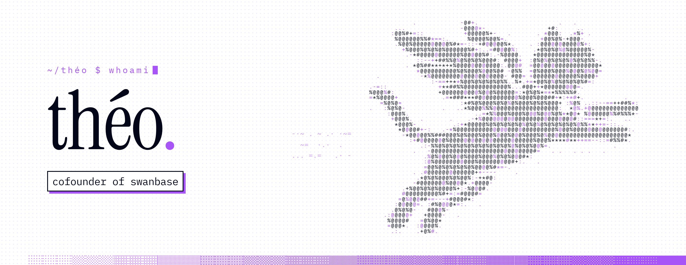</a>

I run [swanbase](https://swanbase.co/en/) with [Vincent](https://github.com/the20100), a growth marketing accelerator in Paris for early-stage European startups. We take founders from their first 10 customers to their first 1,000: ads, cold email, SEO, conversion. It costs them €0, and we stay with them until the exit. Before that, we ran growth for 96 startups at Panja, from 2017 to 2024.

Everything we learn there ends up as a tool, open source when we can. On the side, I research two things: how LLMs reason and make decisions, mostly the cases where they break, and new records in combinatorial design and logic synthesis. Each record comes with the program that builds it and a script that checks it.

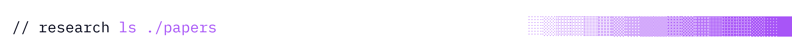

<a href="https://github.com/tns-research/constraint-coherence">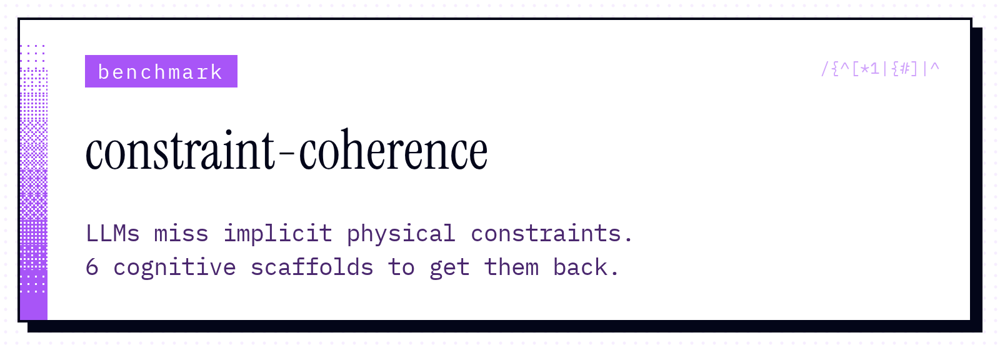</a><a href="https://github.com/tns-research/llm-finance-framework">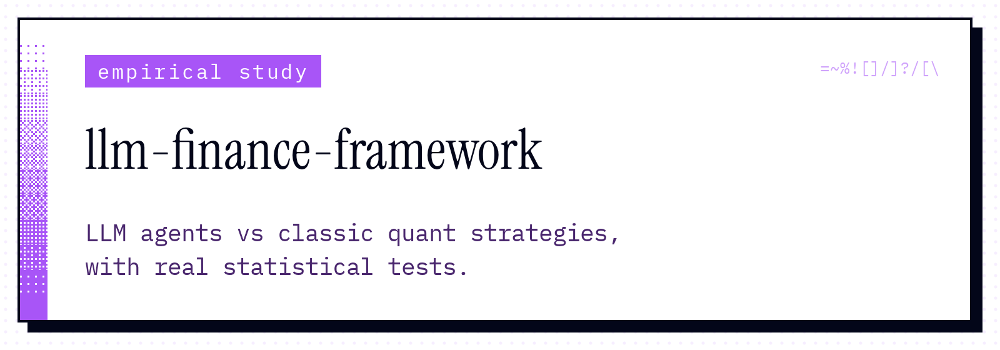</a> 
<a href="https://github.com/tns-research/covering-array-records">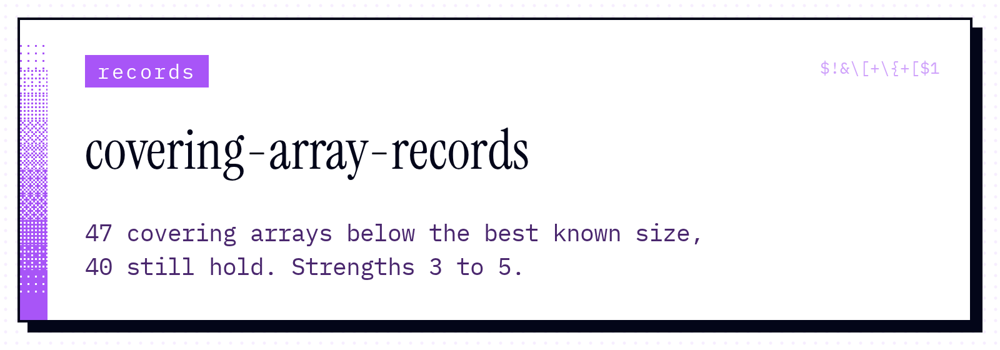</a><a href="https://github.com/tns-research/counterpoint">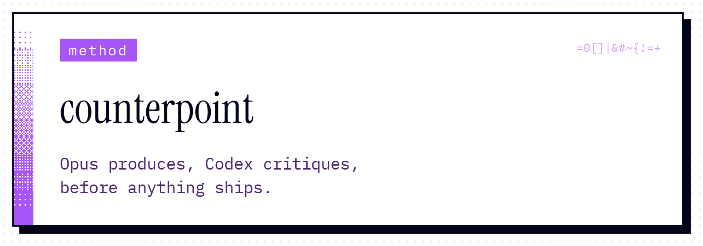</a> 
<a href="https://github.com/tns-research/covering-design-records">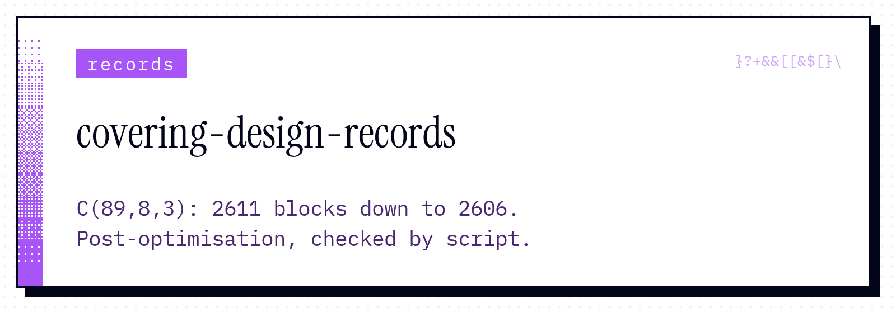</a><a href="https://github.com/tns-research/epfl-benchmark-records">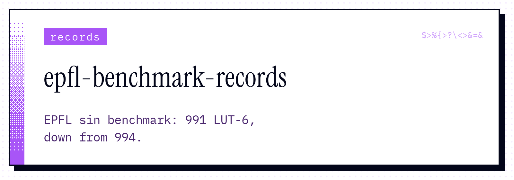</a>

**Preprints** (2026)

- [When Reasoning Scaffolds Backfire: Structured Prompting Creates Systematic Failure Under Constraint Inversion](https://doi.org/10.2139/ssrn.6862624) (SSRN)
- [Large Language Models in Financial Decision-Making: A Methodological Framework for Evaluating AI Trading Strategies](https://doi.org/10.2139/ssrn.6234878) (SSRN)
- [Reasoning Into Confidence: A Controlled Single-Trader Ablation of In-Decision Chain-of-Thought on LLM Trading Performance and Calibration](https://doi.org/10.2139/ssrn.6946379) (SSRN)
- [New upper bounds for covering arrays of strength 3, 4 and 5](https://doi.org/10.5281/zenodo.23842218) (Zenodo)

**Data** (Zenodo, 2026): [covering arrays](https://doi.org/10.5281/zenodo.23741408) · [covering designs](https://doi.org/10.5281/zenodo.23842216) · [EPFL benchmarks](https://doi.org/10.5281/zenodo.23842203)

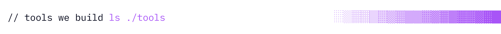

<a href="https://fog-agents.com">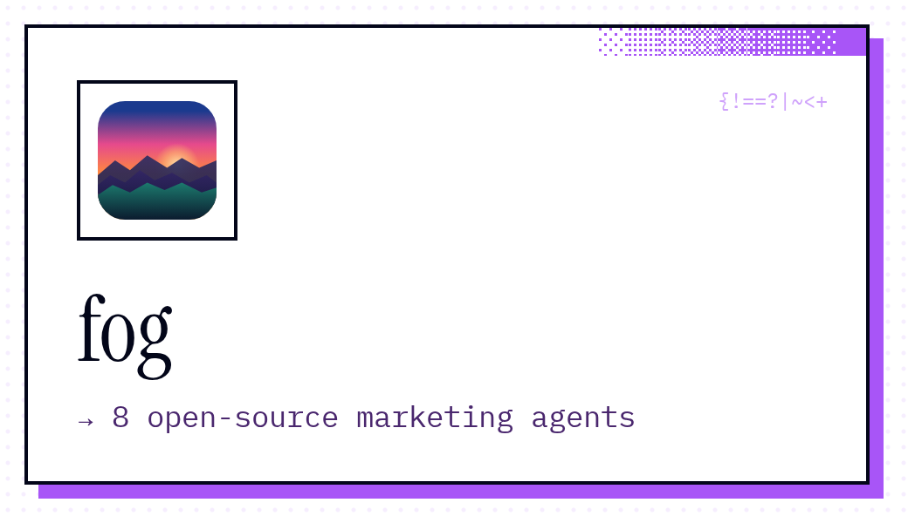</a><a href="https://st4lk.com">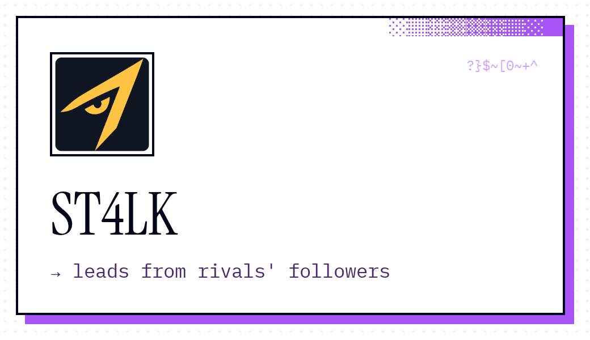</a><a href="https://nametlas.com">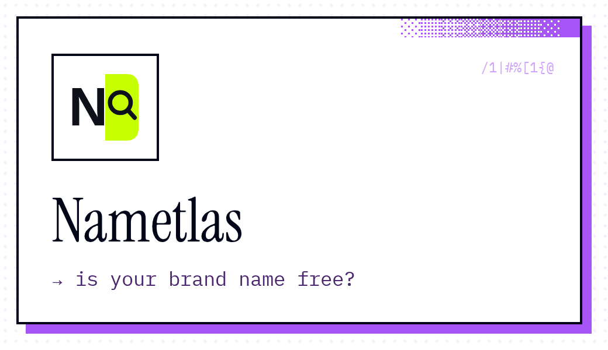</a> 
<a href="https://press3dparis.com">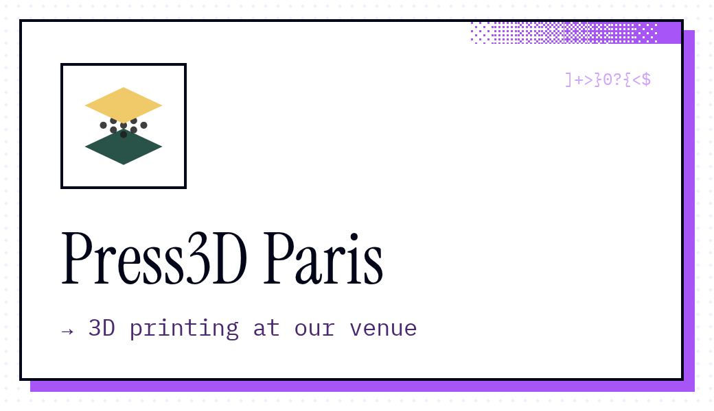</a><a href="https://app.panja.io">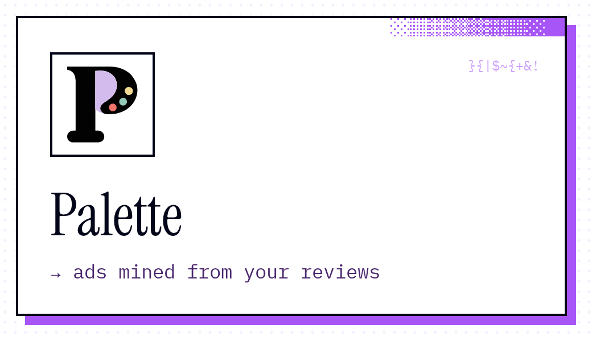</a><a href="https://github.com/tns-research/swanclip">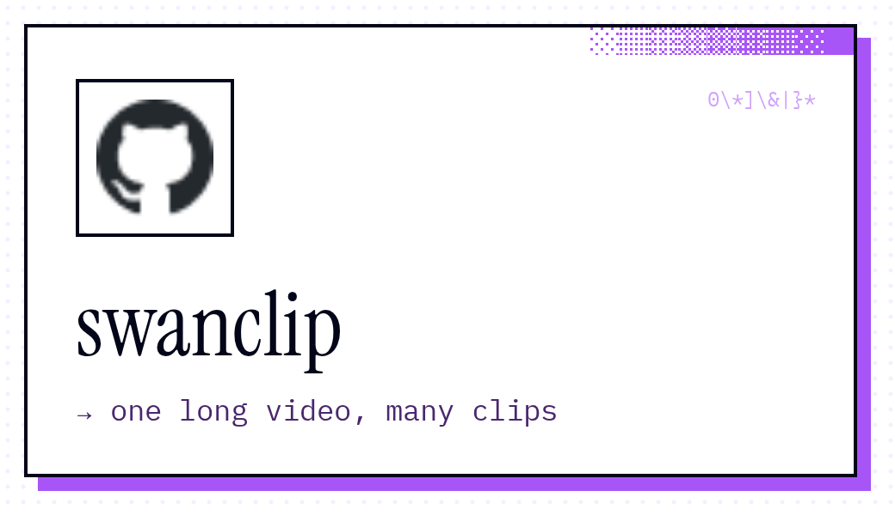</a> 
<a href="https://github.com/tns-research/slopcheck-fr">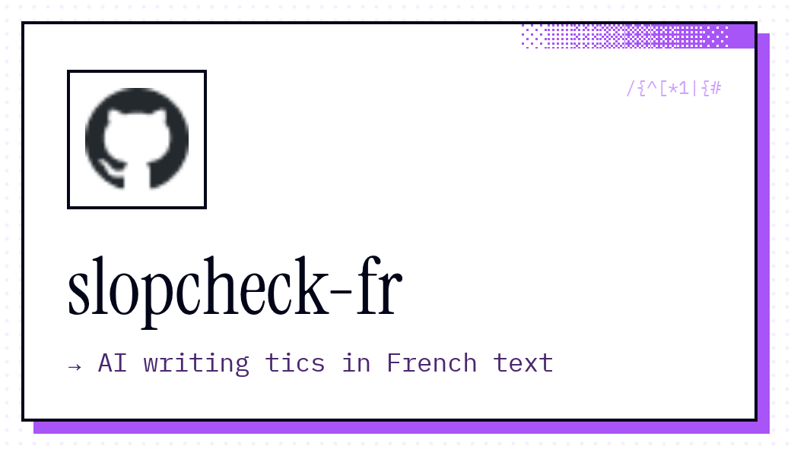</a><a href="https://swanbase.co/en/studio/">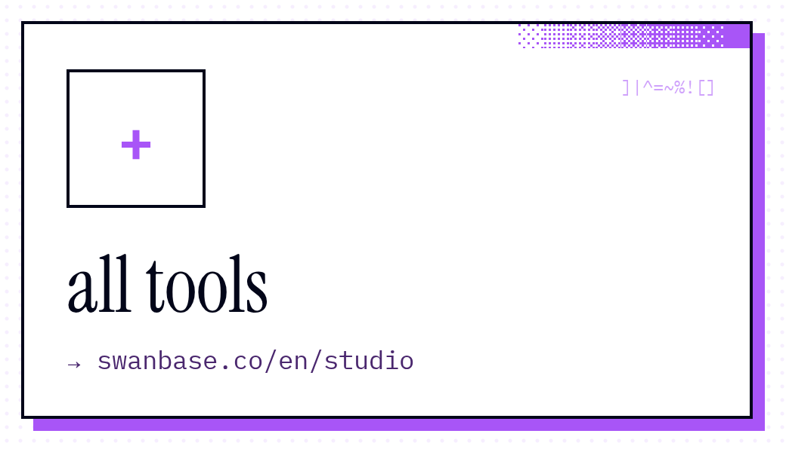</a>

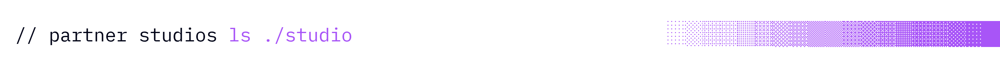

<a href="https://panja.io">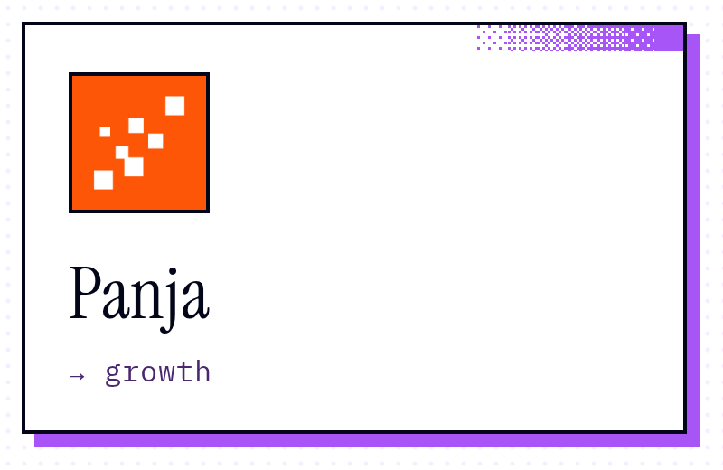</a><a href="https://swanbase.co/en/studio/takema-studio-ugc-video-agency/">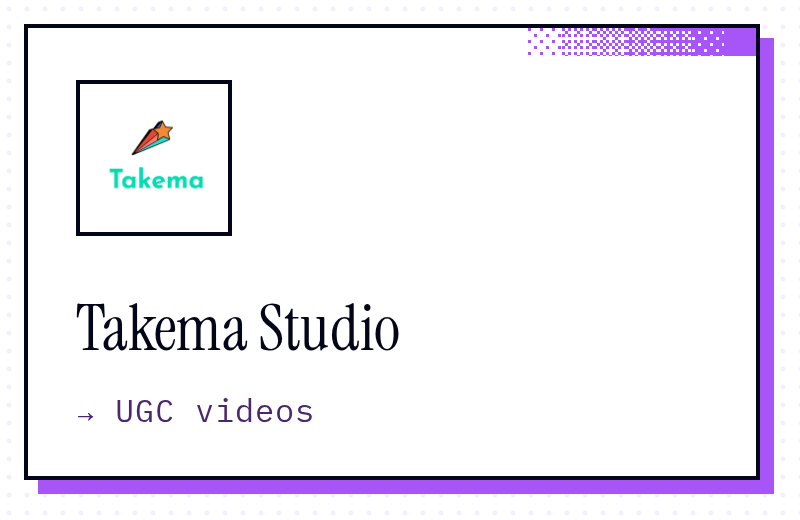</a><a href="https://swanbase.co/en/studio/monweb-dev-website-maintenance-subscription/">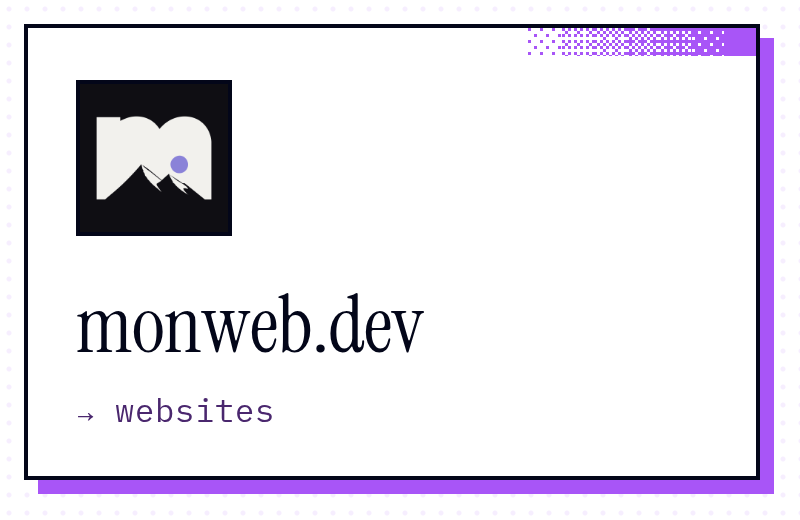</a><a href="https://swanbase.co/en/studio/growth-prospect-cold-email-ai-prospecting/">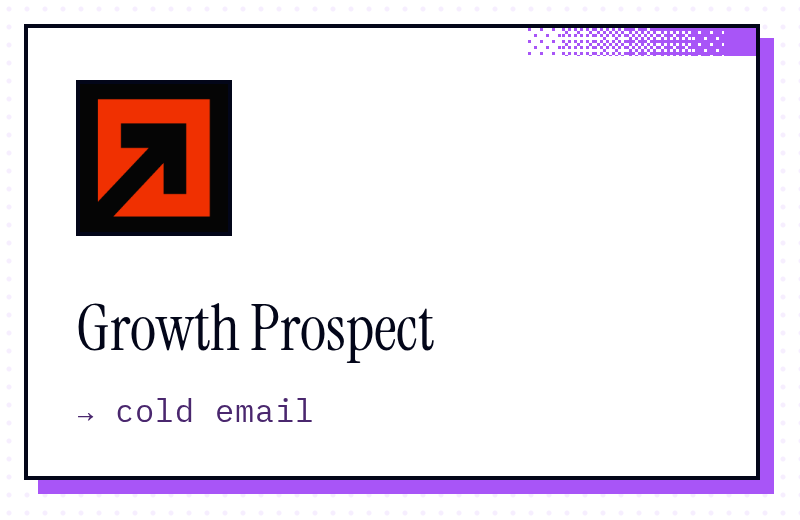</a>

  
  
  
  

